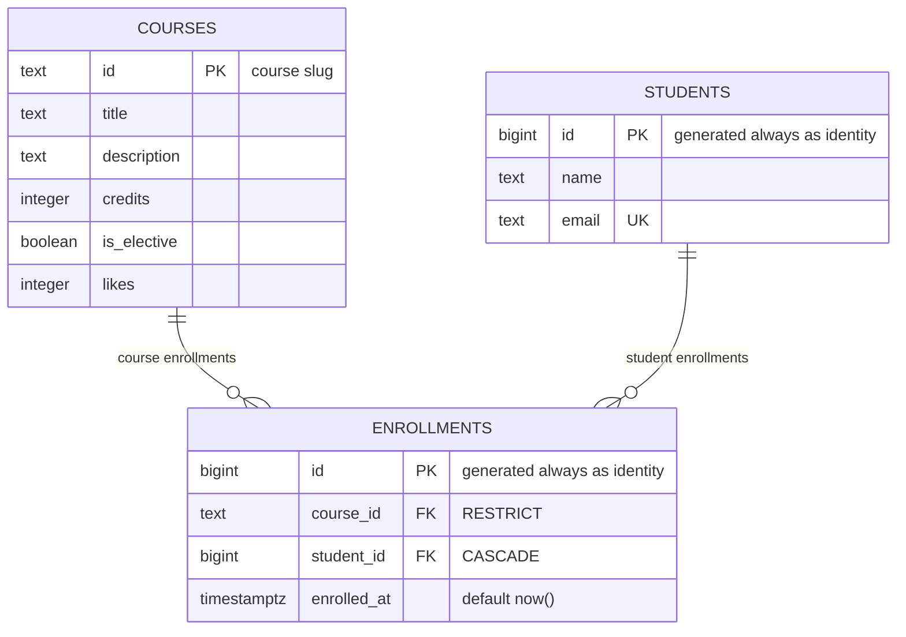

# course-catalog-db

PostgreSQL schema for the course catalog (Lab 6, "Advanced Web Technologies").

Author: **Taskyn Kaltayev**

## How to run

PostgreSQL 16 or newer is required. Once, as the `postgres` superuser:

```sql
CREATE ROLE catalog_app LOGIN PASSWORD 'change-me';
CREATE DATABASE course_catalog OWNER catalog_app;
```

Then, from the project folder (it stops at the first error):

```bash
psql -h localhost -U catalog_app -d course_catalog -v ON_ERROR_STOP=1 -f schema.sql
psql -h localhost -U catalog_app -d course_catalog -v ON_ERROR_STOP=1 -f seed.sql
psql -h localhost -U catalog_app -d course_catalog -v ON_ERROR_STOP=1 -f queries.sql
```

After the first two files the tables hold 6 courses, 3 students and 6 enrollments.
The password `change-me` is for teaching; real projects keep passwords out of git.

The index experiment (step 6) needs a second, throwaway database:

```sql
CREATE DATABASE idx_demo OWNER catalog_app;
```

```bash
psql -h localhost -U catalog_app -d idx_demo -v ON_ERROR_STOP=1 -f schema.sql
psql -h localhost -U catalog_app -d idx_demo -v ON_ERROR_STOP=1 -f experiments/idx_data.sql
```

## Schema



Three tables. `courses` and `students` are independent; `enrollments` links them and holds one
row per "this student is enrolled in this course", with two foreign keys and the time of
enrollment. The many-to-many relationship between courses and students lives exactly there: a
course has many students and a student has many courses, and `enrollments` is the junction table
that resolves it into two one-to-many relationships. The unique pair `(course_id, student_id)`
is what keeps a student from enrolling in the same course twice.

## Design decisions

- **`courses.id` is text, `students.id` is a number.** A course id is a slug written by hand
  (`modern-frontend`): it is readable, it appears in the URL `/courses/modern-frontend`, and the
  frontend from Labs 1–5 already uses it. The price is that renaming a course means changing the
  key and everything that references it. A student has no natural readable identifier, and an
  email can change, so the database issues the number itself: `bigint GENERATED ALWAYS AS
  IDENTITY`. The number never has to change, but it means nothing to a human and does not help
  in a URL.
- **`RESTRICT` on `course_id`, `CASCADE` on `student_id`.** Deleting a course that students are
  enrolled in is almost always a mistake: the enrollments are a record of what actually happened,
  so the database refuses and the API answers 409. A student, on the other hand, may ask to be
  removed, and their enrollments have no meaning without them, so they are deleted along with the
  student. The choice is about meaning, not convenience: `CASCADE` silently destroys rows, so it
  is only put where the child row cannot exist on its own.
- **`timestamptz`, not `timestamp`; `text`, not `varchar(n)`.** `timestamptz` stores the moment
  in UTC and converts it to the client's time zone; plain `timestamp` keeps the digits of a wall
  clock without saying whose clock it is, so two servers in different zones would disagree about
  the same row. `text` and `varchar(n)` are the same type inside PostgreSQL with the same
  performance, but a length limit written into the type is a business rule in the wrong place: it
  takes a migration to change. A real limit, when it is needed, belongs in a `CHECK`.
