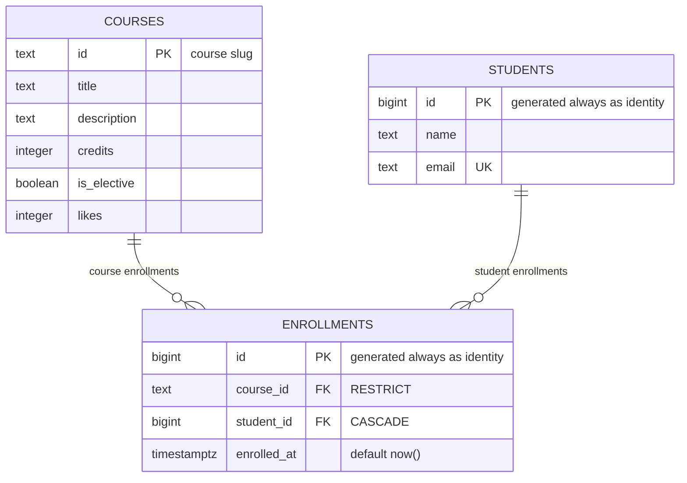

# course-catalog-db

PostgreSQL schema for the course catalog (Lab 6, "Advanced Web Technologies").

Author: **Taskyn Kaltayev**

## How to run

PostgreSQL 16 or newer is required. Once, as the `postgres` superuser:

```sql
CREATE ROLE catalog_app LOGIN PASSWORD 'change-me';
CREATE DATABASE course_catalog OWNER catalog_app;
```

Then, from the project folder (it stops at the first error):

```bash
psql -h localhost -U catalog_app -d course_catalog -v ON_ERROR_STOP=1 -f schema.sql
psql -h localhost -U catalog_app -d course_catalog -v ON_ERROR_STOP=1 -f seed.sql
psql -h localhost -U catalog_app -d course_catalog -v ON_ERROR_STOP=1 -f queries.sql
```

After the first two files the tables hold 6 courses, 3 students and 6 enrollments.
The password `change-me` is for teaching; real projects keep passwords out of git.

The index experiment (step 6) needs a second, throwaway database:

```sql
CREATE DATABASE idx_demo OWNER catalog_app;
```

```bash
psql -h localhost -U catalog_app -d idx_demo -v ON_ERROR_STOP=1 -f schema.sql
psql -h localhost -U catalog_app -d idx_demo -v ON_ERROR_STOP=1 -f experiments/idx_data.sql
```

## Schema



Three tables. `courses` and `students` are independent; `enrollments` links them and holds one
row per "this student is enrolled in this course", with two foreign keys and the time of
enrollment. The many-to-many relationship between courses and students lives exactly there: a
course has many students and a student has many courses, and `enrollments` is the junction table
that resolves it into two one-to-many relationships. The unique pair `(course_id, student_id)`
is what keeps a student from enrolling in the same course twice.

## Design decisions

- **`courses.id` is text, `students.id` is a number.** A course id is a slug written by hand
  (`modern-frontend`): it is readable, it appears in the URL `/courses/modern-frontend`, and the
  frontend from Labs 1–5 already uses it. The price is that renaming a course means changing the
  key and everything that references it. A student has no natural readable identifier, and an
  email can change, so the database issues the number itself: `bigint GENERATED ALWAYS AS
  IDENTITY`. The number never has to change, but it means nothing to a human and does not help
  in a URL.
- **`RESTRICT` on `course_id`, `CASCADE` on `student_id`.** Deleting a course that students are
  enrolled in is almost always a mistake: the enrollments are a record of what actually happened,
  so the database refuses and the API answers 409. A student, on the other hand, may ask to be
  removed, and their enrollments have no meaning without them, so they are deleted along with the
  student. The choice is about meaning, not convenience: `CASCADE` silently destroys rows, so it
  is only put where the child row cannot exist on its own.
- **`timestamptz`, not `timestamp`; `text`, not `varchar(n)`.** `timestamptz` stores the moment
  in UTC and converts it to the client's time zone; plain `timestamp` keeps the digits of a wall
  clock without saying whose clock it is, so two servers in different zones would disagree about
  the same row. `text` and `varchar(n)` are the same type inside PostgreSQL with the same
  performance, but a length limit written into the type is a business rule in the wrong place: it
  takes a migration to change. A real limit, when it is needed, belongs in a `CHECK`.

## Constraint violation log

Commands were run with `\set VERBOSITY verbose` on PostgreSQL 17.11.

| # | What we violate | SQLSTATE | Constraint | API response |
|---|-----------------|----------|------------|--------------|
| 1 | NULL in courses.title | 23502 | no name of its own; the message names the column `title` (COLUMN NAME) | 422; if Pydantic let the empty value through, it is a bug in the code (500) |
| 2 | courses.credits = 0 | 23514 | courses_credits_check | 422 |
| 3 | courses.likes = -1 | 23514 | courses_likes_check | 500: only our code changes the counter with `likes + 1`, so it must never go negative |
| 4 | a one-letter student name | 23514 | students_name_check | 422 |
| 5 | a duplicate student email | 23505 | students_email_key | 409 Conflict |
| 6 | a duplicate course id | 23505 | courses_pkey | 409 Conflict |
| 7 | a repeated enrollment in a course | 23505 | enrollments_course_id_student_id_key | 409 Conflict |
| 8 | enrolling in a nonexistent course | 23503 | enrollments_course_id_fkey | 404: course not found |
| 9 | enrolling a nonexistent student | 23503 | enrollments_student_id_fkey | 404: student not found |
| 10 | deleting a course that has enrollments | 23503 | enrollments_course_id_fkey | 409 Conflict: a course with enrollments cannot be deleted |
| 11 | deleting a student (cascade) | no error | enrollments_student_id_fkey, ON DELETE CASCADE | 204: enrollments went from 6 to 3, and back to 6 after ROLLBACK |

An extra check: `INSERT INTO students (id, …) VALUES (100, …)` gives **428C9** — "cannot insert a
non-DEFAULT value into column id". That code is not from class 23: it is not a user error but a
bug in the code, so the API answers 500.

Experiment 10 gave **23503** on this server. On PostgreSQL 18 the same delete returns 23001 with
the text "violates RESTRICT setting of foreign key constraint". That is why violations are told
apart by the code class (all of them start with 23) and the constraint name, not by the message
text — the text is also localized, and on this machine the server speaks Russian.

After all eleven experiments the tables still held 6, 3 and 6 rows: not a single command changed
the data.

**Why check in the database if Pydantic already checks?** Because the API is not the only thing
that writes to the database. A migration, an admin running `psql` by hand, a background script, a
second service, or a future version of the same API with the check accidentally removed — all of
them reach the table directly and know nothing about `Field(min_length=2)`. A constraint in the
schema is the last line of defense and the only one that cannot be bypassed: it guarantees that
an invalid row simply cannot exist in the table. The Pydantic check is there for a different
reason — to answer the user quickly and clearly (422 with a readable message) before the request
ever reaches the database.

## Index: EXPLAIN before and after

Query: `SELECT * FROM enrollments WHERE student_id = 777;`
Database idx_demo: 500 courses, 20,000 students, 50,000 enrollments.

| | Before the index | After the index |
|---|------------------|-----------------|
| Access method | Seq Scan | Bitmap Index Scan + Bitmap Heap Scan |
| cost | 0.00..1042.00 | 4.31..15.59 |
| Rows Removed by Filter | 49997 | — |
| Execution Time | 4.996 ms | 0.206 ms |

Before:

```
 Seq Scan on enrollments  (cost=0.00..1042.00 rows=3 width=34)
   Filter: (student_id = 777)
```

After:

```
 Bitmap Heap Scan on enrollments  (cost=4.31..15.59 rows=3 width=34)
   Recheck Cond: (student_id = 777)
   ->  Bitmap Index Scan on enrollments_student_id_idx  (cost=0.00..4.31 rows=3 width=0)
         Index Cond: (student_id = 777)
```

The index is not free: the table takes 3336 kB and the index 896 kB, about a quarter of it, and
every insert, update and delete has to be reflected in the index as well. That is why an index is
created for a specific query rather than "just in case".

Answers to the questions:

1. **Why no index on `enrollments.student_id`?** PostgreSQL creates an index automatically only
   for `PRIMARY KEY` and `UNIQUE` — it needs one to enforce them. A `FOREIGN KEY` enforces
   nothing on the referencing side: it checks the parent table, which already has an index on its
   primary key. So `email` got an index from `UNIQUE`, and `course_id` is covered by the index on
   the unique pair `(course_id, student_id)` because it is the pair's first column. `student_id`
   is the pair's second column, and a B-tree cannot be searched by its second column alone.
2. **Why `Seq Scan` on six rows but an index on 50,000?** The planner compares cost, it does not
   follow a rule. All six courses fit on a single data page, so reading the whole table costs
   1.07 — cheaper than reading an index page and then the table page. With 50,000 enrollments a
   sequential scan costs 1042 against 15.59 through the index, so the index wins. "There is an
   index" never means "the index will be used".
3. **Two operations the index speeds up.** Deleting a student: `ON DELETE CASCADE` makes the
   database find that student's enrollments, and without the index it scans the whole table for
   every delete. And the query "one student's enrollments" — the basis of a future route like
   `GET /students/{id}/enrollments`, and of any screen showing what a given student signed up for.

## Transaction

Scenario: enroll a new student in a course — two inserts in one transaction.

- **The second insert failed.** `BEGIN`, then `INSERT INTO students` returned `INSERT 0 1`, and
  the insert into `enrollments` with a nonexistent course failed with a foreign-key violation on
  `enrollments_course_id_fkey`. The transaction went into the aborted state: the next command, a
  harmless `SELECT count(*)`, was rejected with "current transaction is aborted, commands ignored
  until end of transaction block", and the prompt changed to `=!>`. After `ROLLBACK`, a query for
  `madina@example.com` returned 0: the first insert was rolled back too, even though it was
  correct on its own. No student without an enrollment was left behind.
- **Window B** saw `count = 0` while the transaction in window A was open, and `count = 1` right
  after `COMMIT`. Both rows — the student and the enrollment — became visible at the same moment;
  the totals went to 4 students and 7 enrollments. `SHOW default_transaction_isolation` reports
  `read committed`: a session sees only committed data.
- **Without a transaction** each insert would be committed on its own. The student would be
  created, the enrollment would fail, and the database would be left with "half an operation" — a
  student who is not enrolled anywhere. Nothing would report it: both commands return their own
  result, and only the data as a whole is inconsistent. Cleaning that up means finding and
  deleting the orphan by hand.

## Self-review against the checklist

| What to check | Result |
|---------------|--------|
| Keys | Yes. Every table has a primary key; `enrollments` has a foreign key for each of its two relationships. A course slug is a natural key, students and enrollments use `GENERATED ALWAYS AS IDENTITY`. |
| Types | Yes. `timestamptz` for the moment of enrollment, `bigint` for generated identifiers, `integer` for credits and likes, `boolean` for the elective flag, `text` for everything textual. There is no money in this schema; it would be `numeric`. |
| Required values | Yes. Every column in all three tables is `NOT NULL`: there is no row where a title, a credit count or an enrollment time could legitimately be unknown. Defaults cover the two columns the client may omit — `is_elective` and `likes`. |
| Constraints | Yes. `CHECK (credits > 0)`, `CHECK (likes >= 0)`, `CHECK (char_length(name) >= 2)`, `UNIQUE (email)`, `UNIQUE (course_id, student_id)`. The name rule matches `Field(min_length=2)` in the API's Pydantic schema. |
| Deletion | Yes, chosen deliberately. `RESTRICT` on `course_id` protects the enrollment history from a careless delete; `CASCADE` on `student_id` removes enrollments that cannot exist without their student. |
| Normalization | Yes. A course title lives only in `courses`, a student's name only in `students`, and `enrollments` stores two references and a timestamp. There are no repeating groups and no lists packed into one cell. |
| Indexes and names | Yes. The primary keys and both `UNIQUE` constraints give indexes for free; `enrollments_student_id_idx` was added for the foreign key after the `EXPLAIN` experiment showed a `Seq Scan`. No index was added "just in case". Names are consistent snake_case: `courses`, `course_id`, `enrollments_student_id_idx`. |
